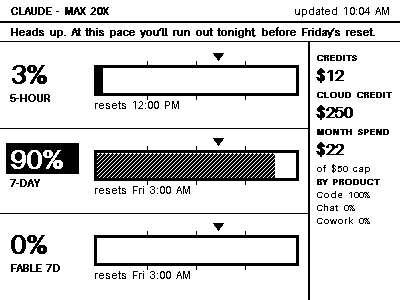
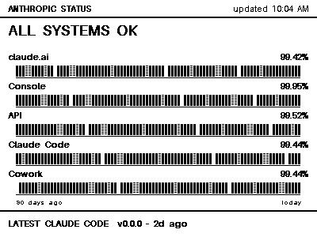

# NOTE4 Claude Usage & Status

Claude plan usage and Anthropic status on a [ZECTRIX NOTE4 Devkit](https://zectrix.com/en/note4-developer-kit.html)
e-paper display (4.2", 400x300, monochrome).

 

*Pages rendered by the collector from sample data (not device photos); the device shows exactly these 1-bit frames.*

> Unofficial. Not affiliated with or endorsed by Anthropic or ZECTRIX Lab.

- **Page 1, usage:** three horizontal gauges (5-hour, weekly, and any model-specific weekly limit) with a big percent,
  25/50/75% ticks, a ▼ marker for how far through the window you are in time, and the reset time. A slim column shows
  credits, cloud credit, month spend and the weekly product split. The top strip shows Anthropic's own pace warning, or a black
  alert band when service is degraded (the incident title, or the site's headline if none is posted).
- **Page 2, status:** the five Anthropic components (claude.ai, Console, API, Claude Code, Cowork), each with its 90-day uptime
  and a strip of 90 same-height bars, one per day: solid is a normal day, striped a partial outage, an empty gap a major
  outage. When service is degraded the page shows an inverted alert band (headline, incident title, status and start time),
  a `DEGRADED` badge on each affected row, and a problem bar for today. The latest Claude Code release is at the bottom.

The numbers come from the claude.ai usage page (`Settings > Usage`), read through a dedicated Chrome profile, so they are
account-wide no matter how many Claude sessions you have running.

## How it fits together

```
claude.ai usage page ──(dedicated Chrome, read over a localhost debug port)──┐
Anthropic status + GitHub releases ───────────────────────────────────────────┤
                                                                              ▼
                                               collector daemon (always-on Mac, LaunchAgent)
                                               parse → render 400x300 1-bit → LAN sink
                                                                              │  HTTP on the LAN (device key)
                                                                              ▼
                                                    NOTE4 DevKit (battery, deep sleep, wakes every 5 minutes)
```

The DevKit fetches `GET /v1/page/{n}.bin` (a raw 15,000-byte frame) with `If-None-Match`, redraws only when the
picture changed, and goes back to sleep. **OK** and **DOWN** wake it and flip between pages (see `firmware/`).

There is also an experimental ZECTRIX Cloud API path (`note4-claude setup --cloud`) meant for retail NOTE4 units. It has
not been tested against a real cloud device. The Developer Kit is not a cloud device, so it uses the LAN path.

## Requirements

macOS, Google Chrome, Python 3.11+, and a **monochrome ZECTRIX NOTE4 Devkit**. The firmware is not for the four-color
NOTE4C: its panel driver differs and the images are not interchangeable. Building the firmware needs ESP-IDF 5.4; there is
no prebuilt image, because the Wi-Fi details, server address and device key are compiled in.

## Install (development Mac)

```bash
python3 -m venv .venv
.venv/bin/pip install -e ".[dev]"
.venv/bin/pytest -q
.venv/bin/note4-claude preview          # render sample pages to ./preview (no login or device needed)
```

## Run it (LAN delivery)

```bash
.venv/bin/note4-claude login            # opens a regular Chrome on the dedicated profile: sign in, then quit Chrome (Cmd+Q)
.venv/bin/note4-claude probe            # check the usage page can be read (starts the collector's Chrome if needed)
.venv/bin/note4-claude setup            # create the device key (owner-only config file)
.venv/bin/note4-claude device-key       # print it, to paste into firmware/main/secrets.local.h (DEVICE_KEY)
.venv/bin/note4-claude doctor --live    # check everything, including a real read
.venv/bin/note4-claude install          # run it in the background (LaunchAgent, restarts if it crashes)
```

The collector reads the usage page by attaching to a normal Chrome that it starts on the dedicated profile (a minimized
window; the debugging port is bound to 127.0.0.1 only). A browser launched by automation gets a "verify you are human"
loop from claude.ai and cannot read the profile's cookies, which is why the collector attaches instead of launching.

## Running on an always-on Mac

Development happens on one Mac; the collector and server run unattended on another.

```bash
scripts/deploy.sh --dry-run USER@HOST      # show what would happen
scripts/deploy.sh --no-install USER@HOST   # FIRST time: copy the code and build the venv, start nothing
# ... sign in on that machine (next paragraph) ...
scripts/deploy.sh USER@HOST                # then: re-sync, create the device key if missing, install the LaunchAgent, run doctor
ssh USER@HOST '~/note4-claude/.venv/bin/note4-claude device-key'   # print the key for the firmware secrets file
```

`deploy.sh` never copies `firmware/` or any `secrets.local.h`. It creates the venv with an explicit Python 3.13 path
(override with `--python`), because a non-interactive SSH session's `python3` can be the old system Python. Use
`--no-install` first so nothing starts before you have signed in: a running collector holds the profile, and `login`
refuses while it does.

**One-time sign-in on that machine.** Cookies are encrypted with that Mac's Keychain, so the profile cannot be copied.
Run `note4-claude login` there (in Terminal in a Screen Sharing session, or from your own Mac with
`ssh USER@HOST '~/note4-claude/.venv/bin/note4-claude login'`; the Chrome window opens on that Mac's screen either way).
Sign in, wait for the normal Claude screen, then quit Chrome with Cmd+Q. Chrome is started through macOS `open`, so it runs
in the GUI session even over SSH; a Chrome exec'd directly from SSH cannot reach the Keychain and would lose the sign-in.

**FileVault and reboots.** With FileVault on, macOS does not allow automatic login. After a reboot the machine waits at
the disk-unlock screen (SSH and the tailnet are down) until someone logs in at it. Once logged in, everything resumes on its
own: the LaunchAgent starts at login, the collector relaunches its Chrome, and the saved sign-in is still valid. If the
network is not up yet, the daemon exits and launchd retries it every 30 seconds. In the meantime the display keeps its last
image and its "updated" clock shows how old it is.

**Addressing.** The DevKit reaches the server by LAN address, so give that Mac a DHCP reservation on your router. The
server binds the LAN address only (never all interfaces), and requires the device key.

**When the display shows LOG IN AGAIN.** The claude.ai session expired. On that Mac: `note4-claude uninstall`, quit the
dedicated Chrome (Cmd+Q), `note4-claude login`, quit Chrome, `note4-claude install`.

**Checking a read while the daemon runs.** `note4-claude push-once` reads and renders without binding the LAN port, so it is safe
to run beside the daemon.

## What you see when something is wrong

| On the screen | Meaning |
|---|---|
| **LOG IN AGAIN** on page 1 | The dedicated profile's claude.ai session expired (see above). |
| **STALE hh:mm** badge on page 1 | No good read for 15 minutes. The last numbers are still shown. |
| An old "updated" time | The collector or the Mac is down, or the device cannot reach it. Check `note4-claude doctor` and `~/Library/Logs/note4-claude.log`. |
| A small banner along the bottom edge | The DevKit's battery is below 10%. |

The "updated" clock only advances when the picture changes or every 30 minutes, so it can trail the real time by up to half
an hour on a quiet day.

## Files

| What | Where |
|---|---|
| Config, including the device key (mode 0600) | `~/.config/note4-claude/config.toml` |
| Push state | `~/.config/note4-claude/state.json` |
| Dedicated Chrome profile | `~/Library/Application Support/note4-claude/profile` |
| Debug captures after 3 parse failures | `~/Library/Application Support/note4-claude/debug` |
| Log | `~/Library/Logs/note4-claude.log` |

## Firmware

`firmware/` is an ESP-IDF 5.4 project derived from the MIT-licensed ZECTRIX NOTE4 reference demo (license and notices
kept). Wi-Fi name, password, server address and device key go in `firmware/main/secrets.local.h`, which is git-ignored;
copy `secrets.example.h` and fill it in. Flashing is over USB from the development Mac. See `firmware/README.md`.

## Privacy

The collector only reads your own usage page. It never extracts, exports or logs cookies or tokens. Frames travel over plain
HTTP on your LAN, protected by the device key; they contain account usage numbers, not credentials.

## Development

```bash
.venv/bin/pytest -q                              # tests
UPDATE_GOLDEN=1 .venv/bin/pytest -q              # regenerate golden images after an intended layout change
.venv/bin/python scripts/dev_lan_server.py       # serve sample pages over the LAN protocol (firmware development)
```

